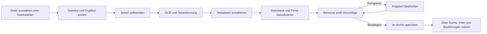
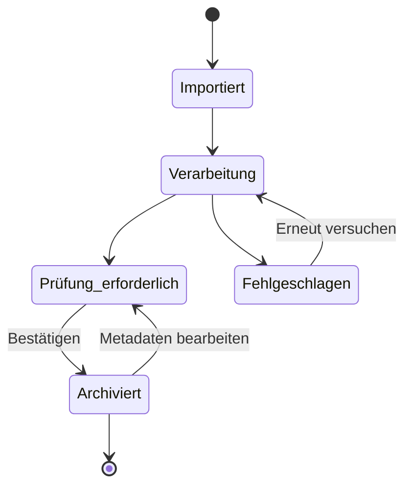
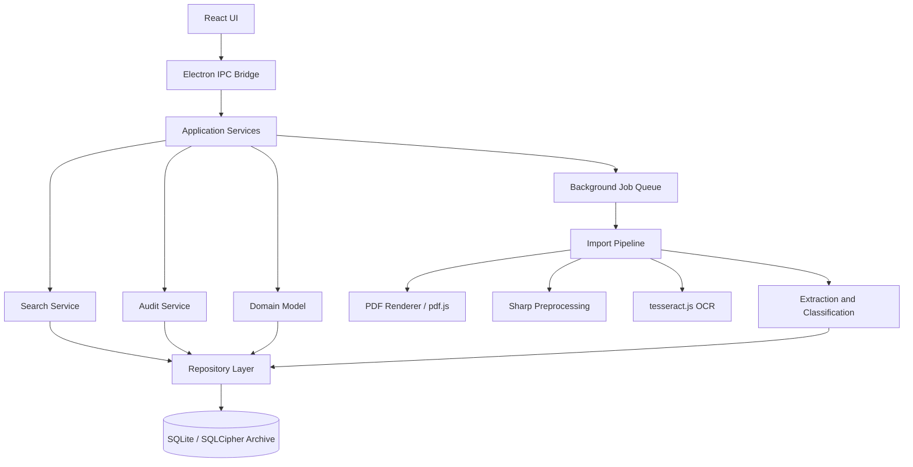

# SaveYourData - Produkt- und Umsetzungsplan

**Status:** Entwurf 1.0  
**Stand:** 26. Juli 2026  
**Zielplattform:** Windows 10/11, später optional Linux und macOS  
**Technische Basis:** Electron, TypeScript und SQLite/SQLCipher

## 1. Kurzbeschreibung

SaveYourData ist eine lokale Desktop-Anwendung zum sicheren Archivieren, Erkennen, Ordnen und Wiederfinden wichtiger Dokumente. Benutzer importieren Fotos, Scans oder PDF-Dateien. Die Anwendung liest deren Inhalt per OCR, erkennt Dokumentart, Firma, Datum, Betrag und weitere Metadaten und schlägt eine passende Ablage vor.

Vor der endgültigen Archivierung bestätigt oder korrigiert der Benutzer die erkannten Angaben. Originaldokumente, Metadaten, Verknüpfungen und Protokolle werden gemeinsam in einem verschlüsselbaren Archiv am gewählten Speicherort verwaltet.

## 2. Produktziele

1. Wichtige Dokumente dauerhaft und nachvollziehbar an einem Ort speichern.
2. Manuelle Ablagearbeit durch OCR und automatische Klassifizierung reduzieren.
3. Jede automatische Erkennung vor der Freigabe durch den Benutzer prüfbar machen.
4. Dokumente über Volltext, Metadaten, Filter und Tags schnell wiederfinden.
5. Zusammengehörige Dokumente, zum Beispiel ein Schreiben und die Antwort, verbinden.
6. Offene, bezahlte oder überfällige Rechnungen sichtbar verwalten.
7. Änderungen und technische Vorgänge vollständig und tageweise nachvollziehbar protokollieren.
8. Alle sensiblen Daten lokal und standardmäßig ohne Cloud-Dienst verarbeiten.

## 3. Annahmen und Rahmen

- Die erste Version ist eine lokale Einzelbenutzer-Anwendung.
- Die Benutzeroberfläche ist zunächst auf Deutsch verfügbar.
- Die Anwendung funktioniert vollständig offline.
- Importiert werden zunächst PDF, PNG, JPEG und TIFF.
- Das Standardarchiv ist eine einzelne SQLite/SQLCipher-Datei.
- Windows ist die erste unterstützte Plattform. Die Kernlogik bleibt portabel.
- Die Anwendung trifft keine rechtlich verbindlichen Entscheidungen und ersetzt keine revisionssichere Buchhaltung.
- Automatische Vorschläge werden niemals ohne sichtbare Bestätigung endgültig übernommen, wenn ihre Sicherheit unter dem festgelegten Grenzwert liegt.

## 4. Abgrenzung der ersten Version

Nicht Bestandteil des MVP:

- Cloud-Synchronisation und Mehrbenutzerbetrieb
- Mobile Apps
- Automatischer E-Mail-Abruf
- Rechtsverbindliche digitale Signaturen
- Steuerberatung oder automatische Buchung
- Automatisches Löschen von Originaldokumenten
- Abhängigkeit von externen KI- oder OCR-Diensten
- Vollautomatisches Training eines eigenen KI-Modells

Diese Punkte können nach einer stabilen lokalen Version geplant werden.

## 5. Benutzerablauf



### Status eines Dokuments



## 6. Funktionale Anforderungen

### FR-01: Archiv anlegen und öffnen

- Beim ersten Start kann der Benutzer ein neues Archiv an einem frei wählbaren Speicherort anlegen oder ein vorhandenes öffnen.
- Ein Archiv besitzt einen Anzeigenamen, eine eindeutige Kennung und eine Schema-Version.
- Verschlüsselung wird beim Anlegen angeboten und für sensible Dokumente empfohlen.
- Das Öffnen eines verschlüsselten Archivs erfordert ein Passwort.
- Ein zuletzt verwendetes Archiv darf nur als Pfad, niemals mit seinem Klartextpasswort, gespeichert werden.
- Ein beschädigtes oder unvollständig migriertes Archiv wird nicht stillschweigend verändert.

### FR-02: Dokumente importieren

- Import über Dateiauswahl und Drag-and-drop.
- Mehrfachauswahl und Stapelimport werden unterstützt.
- Unterstützte MVP-Formate: PDF, PNG, JPEG/JPG und TIFF.
- Der tatsächliche Dateityp wird anhand des Inhalts geprüft, nicht nur anhand der Dateiendung.
- Für jede Datei wird ein SHA-256-Hash berechnet.
- Bei einem identischen Hash wird vor einem doppelten Import gewarnt.
- Das Original wird unverändert gespeichert.
- Importfehler betreffen nur die jeweilige Datei und brechen keinen gesamten Stapel ab.
- Eine Scanner-Anbindung über WIA/TWAIN ist für eine spätere Version vorgesehen.

### FR-03: Bild- und Seitenaufbereitung

- PDF-Seiten werden für OCR in einer konfigurierbaren Auflösung gerendert.
- Bilder können automatisch gedreht, entzerrt, zugeschnitten, entrauscht und kontrastverstärkt werden.
- Mehrseitige Dokumente bleiben als eine logische Einheit erhalten.
- Original und aufbereitete OCR-Version werden getrennt behandelt. Das Original wird nie überschrieben.
- Vorschaubilder werden intern erzeugt und im Archiv zwischengespeichert.

### FR-04: OCR und Volltext

- OCR läuft lokal, zunächst für Deutsch und Englisch.
- Bereits in PDFs vorhandener Text wird bevorzugt übernommen; reine Bildseiten werden per OCR verarbeitet.
- Erkannter Text wird pro Seite gespeichert.
- Die Anwendung speichert für OCR-Ergebnisse eine Konfidenz, Sprache und Engine-Version.
- OCR kann für ein Dokument erneut ausgeführt werden, ohne das Original erneut zu importieren.
- Volltext wird für die Suche indexiert.

### FR-05: Metadaten erkennen

Mindestens folgende Werte werden vorgeschlagen:

- Dokumenttitel
- Dokumentart und Unterart
- Firma oder Absender
- Dokumentdatum
- Rechnungs-, Vertrags-, Kunden- oder Aktennummer, sofern vorhanden
- Betrag und Währung
- Fälligkeitsdatum
- erkannte Sprache
- passende Tags

Regeln für die Erkennung:

- Datumswerte werden zusammen mit ihrem Kontext bewertet, zum Beispiel `Rechnungsdatum` vor einem beliebigen Datum im Fließtext.
- Beim Betrag werden Begriffe wie `Gesamt`, `Endbetrag`, `zu zahlen` und Währung berücksichtigt.
- Jeder Vorschlag enthält einen Konfidenzwert und, soweit möglich, die Fundstelle im Dokument.
- Nicht sicher erkennbare Werte bleiben leer, statt erfunden zu werden.
- Alle Werte bleiben durch den Benutzer änderbar.

### FR-06: Dokumente klassifizieren

Vorgesehene Hauptkategorien:

| Kategorie | Beispiele für Unterkategorien |
| --- | --- |
| Versicherungen | Police, Beitragsrechnung, Schadensfall, Korrespondenz |
| Käufe und Rechnungen | Rechnung, Quittung, Garantie, Bestellung |
| Verträge | Mietvertrag, Mobilfunk, Energie, Abonnement |
| Behörden | Bescheid, Antrag, Meldeunterlage, Schreiben |
| Finanzen und Steuern | Konto, Kredit, Steuerbeleg, Spende |
| Gesundheit | Rechnung, Befund, Rezept, Krankenkasse |
| Arbeit und Bildung | Arbeitsvertrag, Lohnabrechnung, Zeugnis, Zertifikat |
| Allgemeine Korrespondenz | Eingangsschreiben, Antwort, Notiz |
| Sonstiges | Manuell zuzuordnende Dokumente |

- Die erste Klassifizierung kombiniert nachvollziehbare Regeln, Schlüsselwörter und bekannte Firmenprofile.
- Später kann optional ein lokales ONNX-Modell ergänzt werden.
- Kategorie und Unterkategorie besitzen getrennte Konfidenzwerte.
- Benutzerkorrekturen können Firmenaliasen und Regeln verbessern, verändern aber nicht rückwirkend ungefragt andere Dokumente.

### FR-07: Firma erkennen und verwalten

- Firmennamen werden normalisiert und mit vorhandenen Firmen sowie Aliasnamen abgeglichen.
- Wird eine neue Firma mit ausreichender Sicherheit erkannt, fragt die Anwendung, ob ein neuer virtueller Firmenordner angelegt werden soll.
- Der Benutzer kann stattdessen eine bestehende Firma wählen, die Firma umbenennen oder ohne Firma fortfahren.
- Firmen können Aliasnamen, Anschrift, optionale Kontaktdaten, Notizen und Standardkategorien besitzen.
- Das Zusammenführen zweier versehentlich doppelt angelegter Firmen muss möglich sein.

### FR-08: Prüfen und bestätigen

- Nach der Verarbeitung öffnet sich ein Prüfbereich mit Dokumentvorschau und erkannten Angaben nebeneinander.
- Unsichere oder widersprüchliche Felder werden deutlich markiert.
- Die erkannte Fundstelle kann in der Vorschau hervorgehoben werden.
- Der Benutzer kann Werte ändern, entfernen oder ergänzen.
- `Bestätigen` archiviert die geprüften Daten.
- `Später prüfen` lässt das Dokument im Posteingang.
- `Verwerfen` entfernt einen noch nicht bestätigten Import erst nach einer Sicherheitsabfrage.
- Korrekturen werden im Änderungsprotokoll festgehalten.

### FR-09: Metadaten und Anzeigenamen

- Jedes Dokument besitzt einen unveränderlichen Originalnamen und einen frei änderbaren Anzeigenamen.
- Metadaten können optional im angezeigten Namen erscheinen.
- Mögliche Namensbausteine sind Datum, Firma, Kategorie, Betrag und Dokumentnummer.
- Das Namensmuster ist einstellbar, zum Beispiel `{datum} - {firma} - {typ}`.
- Diese Einstellung verändert keine Originaldatei im Archiv.
- Beim Export kann das aktuelle Namensmuster für den Dateinamen verwendet werden.

### FR-10: Suche, Filter und Tags

- Schnellsuche über Titel, OCR-Volltext, Firma, Nummern, Notizen und Tags.
- Kombinierbare Filter für Zeitraum, Kategorie, Firma, Betrag, Währung, Zahlungsstatus, Tags und Prüfstatus.
- Sortierung nach Datum, Importzeit, Firma, Betrag und Relevanz.
- Benutzer können eigene Tags anlegen, umbenennen, zusammenführen und löschen.
- Gespeicherte Suchabfragen sind nach dem MVP vorgesehen.
- Treffer zeigen die relevante Textstelle als Vorschau.

### FR-11: Zahlungsstatus

Für geeignete Dokumente stehen folgende Zustände zur Verfügung:

- Nicht relevant
- Offen
- Teilweise bezahlt
- Bezahlt
- Überfällig
- Strittig

Zusätzlich speicherbar:

- Fälligkeitsdatum
- Zahlungsdatum
- bezahlter Betrag
- Zahlungsnotiz

Der Status `Überfällig` wird aus `Offen` und einem überschrittenen Fälligkeitsdatum abgeleitet. Eine Änderung auf `Bezahlt` erfolgt im MVP nur durch den Benutzer.

### FR-12: Dokumente verbinden

- Dokumente können gerichtete Beziehungen besitzen.
- Beziehungstypen: `Antwort auf`, `gehört zu`, `ersetzt`, `Anlage zu`, `Fortsetzung von` und `Duplikat von`.
- Ein Dokument darf mehrere Beziehungen besitzen.
- Die Detailansicht zeigt alle verbundenen Dokumente und erlaubt direktes Öffnen.
- Das Entfernen einer Beziehung löscht kein Dokument.

### FR-13: Export und Wiederherstellung

- Ein einzelnes Dokument kann im Originalformat exportiert werden.
- Optional werden Metadaten als JSON oder CSV mit exportiert.
- Mehrere Dokumente können als ZIP-Paket exportiert werden.
- Backups werden mit der SQLite-Backup-API als konsistente Archivkopie erzeugt.
- Ein Backup kann vor der Übernahme vollständig geprüft werden.
- Export und Backup werden im Audit-Log protokolliert.
- Die Anwendung warnt, wenn der Zielspeicher nicht genügend freien Platz besitzt.

### FR-14: Tagesprotokolle und Audit-Log

- Relevante Aktionen werden als strukturierte, zeitgestempelte Ereignisse im Archiv gespeichert.
- Erfasst werden mindestens Import, Prüfung, Metadatenänderung, Löschung, Export, Backup, Anmeldung, fehlgeschlagene Entsperrung und Migration.
- Jeder Eintrag enthält Zeit in UTC, lokale Zeitzone, Aktion, betroffenes Objekt, Ergebnis und technische Sitzungskennung.
- Änderungen speichern vorherige und neue Werte, soweit dies ohne unnötige Speicherung sensibler Volltexte möglich ist.
- Protokolle können tageweise angezeigt und exportiert werden.
- Normale Benutzer können Audit-Einträge nicht verändern.
- Technische Diagnosen enthalten keine Passwörter, Schlüssel oder vollständigen Dokumenttexte.

### FR-15: Löschen und Papierkorb

- Archivierte Dokumente werden zunächst in einen Papierkorb verschoben.
- Wiederherstellen ist bis zur endgültigen Löschung möglich.
- Endgültiges Löschen erfordert eine zusätzliche Bestätigung.
- Beziehungen und Suchindex werden bei der endgültigen Löschung konsistent bereinigt.
- Der Vorgang wird protokolliert.
- Für SQLite wird dokumentiert, dass physische Dateibereiche erst nach sicherer Datenbankbereinigung beziehungsweise Neuaufbau freigegeben werden können.

### FR-16: Entwicklerwerkzeuge

- Entwicklerwerkzeuge sind standardmäßig deaktiviert.
- Aktivierung und jedes erneute Öffnen erfordern ein separates Entwicklerpasswort.
- Das Passwort wird mit Argon2id und individuellem Salt gehasht, niemals im Klartext gespeichert.
- Nach mehreren Fehlversuchen greift eine zeitlich begrenzte Sperre.
- Die Ansicht sperrt sich nach Inaktivität erneut.
- Mögliche Werkzeuge: OCR-Rohdaten, Klassifizierungswerte, Jobstatus, Schema-Version, Integritätsprüfung und anonymisierbarer Diagnoseexport.
- Entwicklerwerkzeuge dürfen keine Schlüssel anzeigen und keine Audit-Einträge bearbeiten.
- Gefährliche Operationen, etwa Index-Neuaufbau, benötigen eine separate Bestätigung und vorherige Sicherung.

## 7. Nichtfunktionale Anforderungen

### Sicherheit und Datenschutz

- Lokale Verarbeitung ohne Netzwerkzugriff ist der Standard.
- Das Archiv kann vollständig mit SQLCipher verschlüsselt werden.
- Schlüssel werden nur für die geöffnete Sitzung im Speicher gehalten und beim Sperren entfernt.
- Optionales Merken des Archivzugangs nutzt den sicheren Schlüsselspeicher des Betriebssystems, unter Windows den Credential Manager/DPAPI.
- SQL-Abfragen werden ausschließlich parametrisiert ausgeführt.
- Importierte Dateien werden als nicht vertrauenswürdig behandelt und nie ausgeführt.
- Dateigröße, Seitenzahl und Dekompressionsaufwand erhalten konfigurierbare Grenzen.
- Temporäre Klartextdateien werden vermieden. Unvermeidbare temporäre Daten werden restriktiv angelegt und nach der Verarbeitung entfernt.
- Exporte in unverschlüsselte Ziele benötigen einen klaren Hinweis.

### Electron-Sicherheit

- `contextIsolation: true` und `sandbox` für alle Renderer-Prozesse.
- `nodeIntegration: false`, Kommunikation ausschließlich über Preload-Skripte und IPC-Bridge.
- Content Security Policy (CSP) wird strikt gesetzt, keine `unsafe-eval` oder `unsafe-inline`.
- Externe Ressourcen werden nur von vertrauenswürdigen Quellen geladen.
- `webSecurity: true`, Navigation auf externe URLs wird unterbunden.
- Signierte Builds mit Code-Signing-Zertifikat für Windows (Authenticode) und macOS (notarization).

### Zuverlässigkeit

- Das Originaldokument wird unverändert und mit Prüfsumme gespeichert.
- Schreibvorgänge sind transaktional.
- Hintergrundjobs können nach einem Absturz erkannt und erneut gestartet werden.
- Eine unterbrochene Migration hinterlässt entweder das alte funktionsfähige Schema oder kann aus einem automatischen Backup wiederhergestellt werden.
- Beim Öffnen erfolgt eine leichte Konsistenzprüfung; eine vollständige Prüfung ist manuell verfügbar.

### Leistung

Zielwerte auf einem üblichen Desktop-PC mit SSD:

- Metadatenansichten reagieren innerhalb von 150 ms.
- Eine Suche in 50.000 Dokumenten liefert erste Treffer innerhalb von 500 ms.
- Import und OCR blockieren niemals die Benutzeroberfläche.
- Vorschaubilder werden nur bei Bedarf geladen und begrenzt zwischengespeichert.
- Große BLOBs werden gestreamt und nicht vollständig in den Arbeitsspeicher geladen.

OCR-Zeiten hängen von Seitenzahl, Auflösung und Hardware ab und werden deshalb als Fortschritt statt als feste Laufzeit dargestellt.

### Bedienbarkeit

- Tastaturbedienung für Import, Suche, Prüfung und Speichern.
- Skalierbare Oberfläche für unterschiedliche DPI-Werte.
- Klare Fehlermeldungen mit einer möglichen nächsten Aktion.
- Keine endgültige Löschung oder Überschreibung ohne Bestätigung.
- Datums-, Zahlen- und Währungsformate orientieren sich an der eingestellten Sprache.
- Dark Mode und Light Mode werden unterstützt, umschaltbar und automatisch an die Systemeinstellung anpassbar.

### Wartbarkeit

- TypeScript mit strict mode, ohne plattformspezifische Logik im Domänenkern.
- Klare Trennung von Oberfläche (Renderer), Anwendungslogik (Main), Persistenz und externen Bibliotheken.
- Datenbankschema wird ausschließlich über versionierte Migrationen geändert.
- Öffentliche Kernkomponenten erhalten automatisierte Tests.
- ESLint mit TypeScript-strict-Regeln, keine ungenutzten Warnungen im Projektcode.

## 8. Technische Architektur

### Technologieauswahl

| Bereich | Auswahl | Zweck |
| --- | --- | --- |
| Sprache | TypeScript 5.x (strict) | Kernanwendung und Geschäftslogik |
| Runtime | Node.js 20+ | Backend-Prozesse und native Module |
| Oberfläche | Electron 28+ | Cross-Platform Desktop-Framework |
| UI-Framework | React 18 + Tailwind CSS | Komponenten und Styling |
| Buildsystem | Vite + electron-builder | Entwicklung und Packaging |
| Abhängigkeiten | pnpm | Paketverwaltung |
| Datenbank | better-sqlite3 mit FTS5 | Metadaten, BLOBs und Volltextsuche |
| Verschlüsselung | @journeyapps/sqlcipher | Verschlüsseltes Gesamtarchiv (SQLCipher via better-sqlite3-kompatible API) |
| OCR | tesseract.js | Lokale Texterkennung |
| Bildverarbeitung | sharp | Drehen, Entzerren und Optimieren |
| PDF | pdf.js / pdf-lib | Rendering, Textextraktion und Vorschau |
| Kryptografie | libsodium-wrappers | Argon2id, sichere Zufallswerte und Speicherhilfen |
| Tests | Vitest + Playwright | Unit-, Integrations- und E2E-Tests |
| Packaging | electron-builder | Windows/macOS/Linux-Installer |
| Auto-Update | GitHub REST API | Update-Check beim Start, kein Token nötig |

Vor der Implementierung werden Lizenzen aller Bibliotheken und deren Verteilung im Installer geprüft.

### Komponenten



### Schichten

1. **Presentation:** React-Komponenten, Fenster, Dialoge, Tabellen, Vorschau und Navigation.
2. **IPC Bridge:** Electron-Context-Bridge und Preload-Skripte für sichere Kommunikation zwischen Renderer und Main-Prozess.
3. **Application:** Anwendungsfälle wie Importieren, Bestätigen, Suchen, Verknüpfen und Exportieren (Main-Prozess).
4. **Domain:** Dokumente, Firmen, Kategorien, Tags, Zahlungen, Beziehungen und Regeln (shared, plattformunabhängig).
5. **Infrastructure:** better-sqlite3, tesseract.js, sharp, pdf.js, Dateisystem, libsodium und Betriebssystemintegration.

Abhängigkeiten zeigen nach innen. Der Domänenkern kennt weder React noch better-sqlite3.

### Nebenläufigkeit

- UI-Rendering läuft im Electron-Renderer-Prozess (React).
- Import, Hashing, Seitenrendering, OCR und Vorschaubilder laufen als Worker-Threads oder im Main-Prozess über asynchrone Jobs.
- Pro Dokument werden Pipeline-Schritte in definierter Reihenfolge ausgeführt.
- Datenbankschreibvorgänge werden kurz gehalten und zentral koordiniert.
- Jobs unterstützen Fortschritt, Abbruch und erneuten Versuch.
- Beim Schließen wird auf einen sicheren Transaktionspunkt gewartet oder der Job als fortsetzbar markiert.

## 9. Archiv- und Datenbankkonzept

### Ein-Datei-Archiv

Das Standardarchiv hat die Endung `.syd` und ist technisch eine SQLite- beziehungsweise SQLCipher-Datenbank. Es enthält:

- unveränderte Originaldateien als BLOB
- Vorschaubilder
- OCR-Text und Seiteninformationen
- Metadaten
- Kategorien, Firmen und Tags
- Beziehungen
- Audit-Ereignisse
- Einstellungen, die zum Archiv gehören
- Schema- und Engine-Versionen

SQLite kann während der Nutzung temporäre `-wal`- und `-shm`-Begleitdateien erzeugen. Beim kontrollierten Schließen wird ein WAL-Checkpoint ausgeführt. Für Kopien darf nicht einfach nur die geöffnete Hauptdatei kopiert werden; dafür wird immer die eingebaute Backup-Funktion verwendet.

### Zentrale Tabellen

| Tabelle | Wichtige Inhalte |
| --- | --- |
| `documents` | ID, Originalname, Anzeigename, MIME-Typ, Hash, Status, Firma, Kategorie, Datum, Betrag, Währung, Zahlungsstatus, Zeitstempel |
| `document_blobs` | Originalinhalt, Größe und Prüfsumme |
| `document_pages` | Seitenzahl, OCR-Text, Konfidenz, Sprache, Vorschau |
| `companies` | Name, normalisierter Name, Anschrift, Notizen |
| `company_aliases` | Alternative Schreibweisen einer Firma |
| `categories` | Hierarchische Haupt- und Unterkategorien |
| `tags` | Benutzerdefinierte Tags |
| `document_tags` | Zuordnung zwischen Dokumenten und Tags |
| `document_relations` | Quelle, Ziel und Beziehungstyp |
| `metadata_candidates` | Erkannter Wert, Konfidenz, Fundstelle und Erkennungsregel |
| `jobs` | Pipeline-Status, Fortschritt, Fehler und Wiederholungen |
| `audit_events` | Unveränderliche strukturierte Ereignisse |
| `settings` | Archivbezogene Einstellungen und Namensmuster |
| `schema_migrations` | Ausgeführte Datenbankmigrationen |
| `documents_fts` | FTS5-Index für Volltext und relevante Metadaten |

### Datenregeln

- Interne IDs sind UUIDs und bleiben bei Export oder Wiederherstellung stabil.
- Zeitstempel werden in UTC gespeichert und lokal angezeigt.
- Geldbeträge werden als ganzzahlige kleinste Währungseinheit plus ISO-4217-Währung gespeichert, nie als Gleitkommazahl.
- Datumswerte unterscheiden zwischen genauem Datum, Monat/Jahr und unbekannter Genauigkeit.
- Löschregeln und Fremdschlüssel sind explizit definiert und getestet.
- Jede Schemaänderung besitzt eine vorwärts gerichtete Migration und eine getestete Backup-Strategie.

## 10. Erkennungsstrategie

### MVP

1. Text aus PDF übernehmen oder per Tesseract erkennen.
2. Text normalisieren, ohne den Rohtext zu verlieren.
3. Kandidaten für Datum, Betrag, Währung, Nummern und Firma ermitteln.
4. Kandidaten anhand von Schlüsselwörtern, Position und Format bewerten.
5. Firma über normalisierte Namen und Aliasnamen abgleichen.
6. Kategorie über gewichtete, nachvollziehbare Regeln bestimmen.
7. Ergebnis mit Konfidenz und Fundstellen zur Prüfung übergeben.

### Konfidenzregeln

- `>= 0,90`: hoher Wert, normal anzeigen
- `0,65 bis 0,89`: sichtbar als prüfenswert markieren
- `< 0,65`: nicht automatisch übernehmen, nur als möglicher Vorschlag zeigen
- Widersprüchliche Kandidaten werden immer markiert.
- Grenzwerte sind intern konfigurierbar und werden anhand anonymisierter Testdokumente kalibriert.

### Spätere Verbesserung

- Optionales lokales ONNX-Modell für Dokumentklassifizierung
- Layout-Erkennung für Tabellen und Formularfelder
- Vorschläge aus bestätigten, lokalen Firmen- und Kategorienmustern
- Weitere OCR-Sprachen als installierbare Sprachpakete

Externe Dienste werden nur als ausdrücklich aktivierbare Erweiterung geplant und senden niemals Daten ohne vorherige Zustimmung.

## 11. Benutzeroberfläche

### Hauptbereiche

1. **Posteingang:** Neue, laufende, fehlgeschlagene und noch zu prüfende Importe.
2. **Prüfen:** Große Dokumentvorschau plus editierbare Erkennungsfelder.
3. **Archiv:** Dichte Listen- oder Tabellenansicht mit Sortierung und Filtern.
4. **Dokumentdetails:** Metadaten, Seiten, Zahlungsstatus, Tags, Beziehungen und Historie.
5. **Suche:** Volltextfeld, kombinierbare Filter und hervorgehobene Trefferstellen.
6. **Firmen:** Virtuelle Firmenordner, Aliasnamen und zugehörige Dokumente.
7. **Protokoll:** Tagesansicht und Export des Audit-Logs.
8. **Einstellungen:** Archiv, OCR, Sprache, Namensmuster, Backup und Sicherheit.
9. **Entwicklerwerkzeuge:** Passwortgeschützter Diagnosebereich.
10. **Dashboard:** Übersicht mit Archivstatistiken, Dokumentanzahl pro Kategorie, offene Zahlungen, zuletzt importierte Dokumente und Speicherplatzverbrauch.

### Wichtige Interaktionen

- Globale Suche bleibt aus allen Hauptansichten erreichbar.
- Der Importstatus ist sichtbar, ohne die aktuelle Arbeit zu unterbrechen.
- Die Prüfmaske unterstützt `Speichern und nächstes Dokument`.
- Filterzustände sind sichtbar und einzeln entfernbar.
- Verknüpfungen werden per Suchdialog erstellt, nicht durch Eingabe technischer IDs.
- Sensible Aktionen verwenden eindeutige Bezeichnungen statt allgemeiner Bestätigungsfragen.

## 12. Vorgeschlagene Projektstruktur

```text
SaveYourData/
|-- package.json
|-- tsconfig.json
|-- electron-builder.yml
|-- vite.config.ts
|-- build.bat
|-- build.sh
|-- docs/
|   |-- architecture.md
|   |-- database.md
|   `-- security.md
|-- src/
|   |-- main/
|   |   |-- app/
|   |   |-- infrastructure/
|   |   |   |-- database/
|   |   |   |-- import/
|   |   |   |-- ocr/
|   |   |   |-- pdf/
|   |   |   `-- security/
|   |   `-- index.ts
|   |-- preload/
|   |   `-- index.ts
|   |-- renderer/
|   |   |-- components/
|   |   |-- hooks/
|   |   |-- pages/
|   |   |-- stores/
|   |   `-- App.tsx
|   `-- shared/
|       `-- domain/
|-- resources/
|   |-- migrations/
|   `-- translations/
|-- tests/
|   |-- unit/
|   |-- integration/
|   |-- e2e/
|   `-- fixtures/
`-- packaging/
```

### Build-Skripte

`build.bat` (Windows) und `build.sh` (Linux/macOS) sind interaktive Hilfsskripte im Projektstammverzeichnis, die den Entwicklungs-Workflow vereinfachen:

```
╔══════════════════════════════════╗
║   SaveYourData Build Script    ║
╠══════════════════════════════════╣
║ [1] Requirements installieren   ║
║     → pnpm install              ║
║     → Prüft Node.js 20+         ║
║ [2] App bauen                   ║
║     → pnpm build                ║
║     → electron-builder          ║
║ [3] Beides (1 + 2)              ║
║ [4] Beenden                     ║
╚══════════════════════════════════╝
```

- **Option 1**: Installiert alle Abhängigkeiten (`pnpm install`) und prüft, ob Node.js 20+ vorhanden ist.
- **Option 2**: Führt den Produktions-Build aus (`pnpm build` + `electron-builder`).
- **Option 3**: Kombiniert 1 und 2 in einem Durchlauf.
- **Option 4**: Beendet das Skript.

## 13. Fehlerbehandlung

- Benutzerfehler, Dokumentfehler und interne Fehler werden unterschieden.
- Jede Meldung erklärt, was fehlgeschlagen ist und welche sichere Aktion möglich ist.
- Technische Details erhalten eine Fehler-ID und landen im Diagnoseprotokoll.
- Defekte Einzeldokumente stoppen nicht die Verarbeitung anderer Dokumente.
- Wiederholbare Jobs verwenden eine begrenzte Anzahl von Versuchen.
- Ein Job wird nur dann automatisch wiederholt, wenn dadurch kein doppelter Import entstehen kann.
- Nicht behandelbare Datenbank- oder Kryptografiefehler versetzen das Archiv in einen schreibgeschützten Sicherheitsmodus.

## 14. Teststrategie

### Unit-Tests

- Normalisierung von Firmen und Aliasnamen
- Datums-, Betrags- und Währungserkennung
- Kategorien und Konfidenzberechnung
- Zahlungsstatus und Fälligkeit
- Dateinamensmuster
- Beziehungen und Löschregeln
- Passwort- und Sperrlogik

### Integrationstests

- Datenbank anlegen, verschlüsseln, öffnen und migrieren
- BLOBs streamen und über SHA-256 verifizieren
- PDF- und Bildimport mit OCR
- FTS5-Index aktualisieren und durchsuchen
- Audit-Ereignisse vollständig und unveränderbar schreiben
- Backup während geöffneter Datenbank erstellen und wiederherstellen
- Unterbrochene Jobs fortsetzen

### Systemtests

- Vollständiger Ablauf vom Import bis zur bestätigten Archivierung
- Neue Firma erkennen und virtuellen Ordner anlegen
- Rechnung als bezahlt markieren und filtern
- Schreiben mit Antwort verbinden
- Dokument exportieren und Prüfsumme vergleichen
- Papierkorb, Wiederherstellung und endgültiges Löschen
- Entwicklerwerkzeuge sperren, entsperren und automatisch erneut sperren

### Testdaten

- Ausschließlich künstliche oder ausdrücklich freigegebene Dokumente verwenden.
- Testbestand umfasst verschiedene Auflösungen, Drehungen, Sprachen und mehrseitige PDFs.
- Erwartete OCR- und Metadatenergebnisse werden versioniert gespeichert.
- Keine privaten Dokumente in das Repository einchecken.

### Qualitätsprüfungen

- Debug- und Release-Build in CI
- Unit- und Integrationstests über Vitest
- E2E-Tests mit Playwright
- Statische Analyse mit ESLint + TypeScript strict
- Formatprüfung mit Prettier
- Abhängigkeits- und Lizenzprüfung vor Releases
- Manuelle Prüfung von Backup und Wiederherstellung für jedes Release

## 15. Umsetzungsphasen

### Phase 0: Entscheidungen und technische Prototypen

- [ ] Unterstützte Windows-Versionen und Electron-28-Version festlegen.
- [ ] Lizenzen von Electron, better-sqlite3, SQLCipher, tesseract.js, sharp und pdf.js prüfen.
- [ ] SQLite-BLOB-Streaming mit einer großen Testdatei validieren.
- [ ] Verschlüsseltes Archiv inklusive Backup und Wiederherstellung erproben.
- [ ] OCR-Qualität für deutsche Rechnungen, Schreiben und Scans messen.
- [ ] Beispieldokumente und erwartete Ergebnisse als Testkorpus erstellen.

**Abnahme:** Die Kernbibliotheken lassen sich gemeinsam bauen, ein verschlüsseltes Testarchiv kann eine große PDF verlustfrei speichern und wieder exportieren, und OCR liefert reproduzierbare Ergebnisse.

### Phase 1: Anwendungs- und Archivgrundlage

- [ ] pnpm-, Vite-, CI- und Teststruktur einrichten.
- [ ] Electron-Hauptfenster mit Archivauswahl und React-UI erstellen.
- [ ] Datenbankverbindung, Migrationen und Repository-Schicht implementieren.
- [ ] Neues verschlüsseltes und unverschlüsseltes Archiv anlegen.
- [ ] Sperren, Entsperren und sichere Fehlerzustände implementieren.
- [ ] Audit-Grundfunktion einführen.

**Abnahme:** Ein Benutzer kann ein Archiv anlegen, schließen und erneut öffnen. Falsche Passwörter verändern das Archiv nicht. Schema und Basisaktionen sind protokolliert.

### Phase 2: Import und Dokumentanzeige

- [ ] Datei- und Drag-and-drop-Import umsetzen.
- [ ] MIME-Prüfung, Größenlimits, SHA-256 und Duplikatwarnung ergänzen.
- [ ] Originaldateien transaktional als BLOB speichern.
- [ ] PDF- und Bildvorschau implementieren.
- [ ] Hintergrundjobs mit Fortschritt, Abbruch und Wiederholung umsetzen.
- [ ] Export mit Hashvergleich implementieren.

**Abnahme:** Unterstützte Dateien werden ohne Veränderung importiert, angezeigt und bitgenau exportiert. Duplikate und beschädigte Dateien werden kontrolliert behandelt.

### Phase 3: OCR und Metadatenextraktion

- [ ] PDF-Textübernahme und Seitenerkennung implementieren.
- [ ] Sharp-Aufbereitung integrieren.
- [ ] Tesseract für Deutsch und Englisch anbinden.
- [ ] OCR-Ergebnisse pro Seite speichern und mit FTS5 indexieren.
- [ ] Datum, Betrag, Währung und Nummern erkennen.
- [ ] Konfidenzen und Fundstellen speichern.

**Abnahme:** Ein Testkorpus wird im Hintergrund verarbeitet, bleibt bedienbar und liefert durchsuchbaren Volltext sowie nachvollziehbare Metadatenvorschläge.

### Phase 4: Klassifizierung und Prüfworkflow

- [ ] Kategorie- und Unterkategoriesystem implementieren.
- [ ] Firmen, Aliasnamen und Normalisierung umsetzen.
- [ ] Regelbasierte Klassifizierung implementieren.
- [ ] Prüfmaske mit Vorschau, Fundstellen und editierbaren Feldern erstellen.
- [ ] Nachfrage für neue virtuelle Firmenordner umsetzen.
- [ ] Posteingang und Fehleransicht fertigstellen.

**Abnahme:** Kein unsicher verarbeitetes Dokument gelangt ohne sichtbare Prüfung in den bestätigten Bestand. Korrekturen und neue Firmen werden konsistent gespeichert und protokolliert.

### Phase 5: Organisieren und Finden

- [ ] Archivansicht mit Sortierung und Filterung erstellen.
- [ ] Volltext- und Metadatensuche implementieren.
- [ ] Tags und Tagverwaltung ergänzen.
- [ ] Konfigurierbare Anzeigenamen und Exportnamen umsetzen.
- [ ] Dokumentdetailansicht und Änderungshistorie erstellen.
- [ ] Papierkorb und Wiederherstellung implementieren.

**Abnahme:** Dokumente lassen sich über Volltext, Firma, Kategorie, Datum, Betrag und Tags finden. Originalnamen bleiben unverändert.

### Phase 6: Erweiterte Dokumentverwaltung

- [ ] Zahlungsstatus, Fälligkeit und Zahlungsdaten ergänzen.
- [ ] Dokumentbeziehungen und Beziehungssuche implementieren.
- [ ] Tagesansicht und Export des Audit-Logs umsetzen.
- [ ] Konsistente Backup- und Wiederherstellungsoberfläche erstellen.
- [ ] Passwortgeschützte Entwicklerwerkzeuge implementieren.

**Abnahme:** Zahlungen, Beziehungen, Backups, Tagesprotokolle und Entwicklerzugriff erfüllen die jeweiligen funktionalen und sicherheitsbezogenen Anforderungen.

### Phase 7: Stabilisierung und erste Veröffentlichung

- [ ] Barrierearme Tastatur- und DPI-Prüfung durchführen.
- [ ] Leistung mit mindestens 50.000 synthetischen Dokumenteinträgen messen.
- [ ] Absturz-, Speicherplatz- und Stromausfallszenarien testen.
- [ ] Installer, Deinstallation und Upgradepfad erstellen.
- [ ] Benutzeranleitung, Sicherheits- und Backup-Anleitung verfassen.
- [ ] Drittanbieterlizenzen und Release-Artefakte prüfen.

**Abnahme:** Alle MVP-Abnahmekriterien sind erfüllt, es gibt keine bekannten kritischen Datenverlust- oder Sicherheitsfehler, und Installation sowie Upgrade wurden auf sauberen Windows-Systemen getestet.

## 16. MVP-Abnahmekriterien

Das MVP gilt als fertig, wenn alle folgenden Punkte erfüllt sind:

- [ ] Ein Archiv kann am gewünschten Ort angelegt, verschlüsselt, geschlossen und wieder geöffnet werden.
- [ ] PDF-, PNG-, JPEG- und TIFF-Dokumente können importiert werden.
- [ ] Originale lassen sich nach dem Export per SHA-256 unverändert bestätigen.
- [ ] OCR erkennt und indexiert deutsche sowie englische Dokumente lokal.
- [ ] Datum, Betrag, Währung, Firma und Dokumentart werden mit Konfidenz vorgeschlagen.
- [ ] Benutzer können alle Vorschläge vor der Archivierung prüfen und korrigieren.
- [ ] Neue Firmen lösen die Nachfrage nach einem virtuellen Firmenordner aus.
- [ ] Suche, Filter, Tags und optionale Metadaten im Anzeigenamen funktionieren.
- [ ] Zahlungsstatus und Fälligkeit können gepflegt und gefiltert werden.
- [ ] Dokumente können miteinander verbunden und über Beziehungen geöffnet werden.
- [ ] Relevante Aktionen erscheinen vollständig im tageweise abrufbaren Audit-Log.
- [ ] Entwicklerwerkzeuge sind standardmäßig aus und wirksam passwortgeschützt.
- [ ] Backup und Wiederherstellung wurden mit einem realistischen großen Testarchiv erfolgreich geprüft.
- [ ] Ein Absturz während OCR oder Import beschädigt weder bestätigte Dokumente noch das Archiv.
- [ ] Alle automatisierten Tests und Qualitätsprüfungen laufen erfolgreich.

## 17. Risiken und Gegenmaßnahmen

| Risiko | Auswirkung | Gegenmaßnahme |
| --- | --- | --- |
| Schlechte Scanqualität | Falsche OCR und Metadaten | Bildaufbereitung, Konfidenzen, Fundstellen und manuelle Prüfung |
| Sehr großes Ein-Datei-Archiv | Langsame Backups oder aufwendige Reparatur | BLOB-Streaming, Größenwarnungen, getestete Backup-API und Integritätsprüfung |
| Verlust des Archivpassworts | Daten nicht wiederherstellbar | Deutliche Warnung, optionaler Wiederherstellungsschlüssel und dokumentierter Backup-Prozess |
| Abbruch während Schreibvorgang | Inkonsistente Jobs oder Daten | Transaktionen, WAL, Jobstatus und Wiederanlauf |
| Falsche Firmenzusammenführung | Fehlablage vieler Dokumente | Vorschau, explizite Bestätigung und protokollierte Zusammenführung |
| Schadhaftes PDF oder Bild | Absturz oder hoher Ressourcenverbrauch | Parser-Isolation soweit praktikabel, Grenzen und robuste Fehlerbehandlung |
| Unbemerkte Datenkorruption | Dokumentverlust | SHA-256, Integritätsprüfung, regelmäßige verifizierte Backups |
| Lizenzkonflikt | Veröffentlichung blockiert | Lizenzprüfung in Phase 0 und vor jedem Release |
| Sensible Daten in Logs | Datenschutzproblem | Strukturierte Logs ohne Volltext, Geheimnisse oder Schlüssel |

## 18. Offene Produktentscheidungen

Diese Punkte blockieren die Planerstellung nicht, müssen aber spätestens in Phase 0 entschieden werden:

1. Soll Verschlüsselung verpflichtend oder nur der empfohlene Standard sein?
2. Soll zusätzlich zum Passwort ein druckbarer Wiederherstellungsschlüssel angeboten werden?
3. Welche maximale Einzeldateigröße und Archivgröße werden offiziell unterstützt?
4. Ist eine direkte WIA/TWAIN-Scanneranbindung für Version 1.0 erforderlich?
5. Werden medizinische Dokumente im MVP als eigene Kategorie benötigt?
6. Soll ein Archiv automatisch nach einer bestimmten Inaktivitätsdauer gesperrt werden?
7. Welche Regeln gelten für die endgültige Löschung und Aufbewahrungsfristen?
8. Sollen gespeicherte Suchen und Zahlungserinnerungen noch Teil von Version 1.0 werden?

## 19. Mögliche Erweiterungen nach dem MVP

- WIA/TWAIN-Scannerintegration
- Überwachter Importordner: Automatischer Import neuer Dateien aus einem konfigurierbaren Ordner
- E-Mail-Import
- Lokale Zahlungserinnerungen
- Gespeicherte Suchen und intelligente Sammlungen
- Lokales ONNX-Modell für bessere Klassifizierung
- Tabellen- und Formularerkennung
- Mehrere Archive und Archivzusammenführung
- Mehrbenutzerrollen
- Verschlüsselte Synchronisation zwischen eigenen Geräten
- Mobile Erfassungs-App
- Standardisierte Exporte für Buchhaltungssysteme
- Dokument-Transfer vom Smartphone via [Localsend](https://github.com/localsend/localsend) (lokal, verschlüsselt, quelloffen)
- Ablauffristen für Dokumente (Garantie, Vertrag, Ausweis) mit Erinnerungsfunktion
- Stapelverarbeitung: Mehrere Dokumente gleichzeitig taggen, kategorisieren oder Metadaten setzen

## 20. Definition of Done für jede Funktion

Eine Funktion ist erst abgeschlossen, wenn:

- die fachlichen Abnahmekriterien erfüllt sind,
- Fehler- und Abbruchpfade behandelt werden,
- sicherheitsrelevante Auswirkungen geprüft sind,
- passende Unit- oder Integrationstests vorhanden sind,
- Audit-Ereignisse ergänzt wurden, falls Daten verändert werden,
- Oberfläche und Tastaturbedienung geprüft wurden,
- notwendige Datenbankmigrationen getestet sind,
- Benutzer- oder Entwicklerdokumentation aktualisiert ist,
- Release-Build, Tests und statische Analyse erfolgreich laufen.

## 21. CI/CD und GitHub-Workflows

### Automatisierte Workflows

Die folgenden GitHub-Actions-Workflows werden im Repository unter `.github/workflows/` eingerichtet:

#### build.yml – Build bei Push und Pull Request

- Läuft bei jedem Push auf `main` und bei jedem Pull Request.
- Checkout, Node.js 20+ Setup, pnpm-Installation.
- TypeScript-Check (`tsc --noEmit`), ESLint, Prettier-Prüfung.
- Unit- und Integrationstests mit Vitest.
- Build von Main- und Renderer-Prozess (`pnpm build`).
- E2E-Tests mit Playwright (headless).
- Hochladen der Build-Artefakte als ZIP.

#### release.yml – Release bei veröffentlichtem GitHub Release

- Läuft bei `release: [published]`.
- Baut die Anwendung mit `electron-builder` für Windows, macOS und Linux.
- Erzeugt Installer (`.exe`, `.dmg`, `.AppImage`).
- Hängt die Installer-Artefakte an das Release an.
- SHA-256-Prüfsummen für alle Artefakte generieren.
- Der Windows-Installer wird als `SaveYourData-Setup.exe` bereitgestellt (wird vom Update-Check referenziert).

#### issue-triage.yml – Automatische Issue-Klassifizierung

- Läuft bei `issues: [opened]`.
- Verwendet `actions/github-script@v7`.
- **Komponenten-Klassifizierung** in zwei Phasen:
  1. Parst das Template-Dropdown-Feld (`### Komponente`) aus dem Issue-Body.
  2. Fallback: Keyword-Erkennung (Renderer, Main, OCR, Datenbank, Installer).
- **Typ-Erkennung**: Bug vs. Enhancement anhand vorhandener Labels und Keyword-Fallback.
- **Auto-Assignment**: Weist automatisch dem Maintainer zu.
- **Blocker-Erkennung**: Erkennt `blocked by #123` / `blockiert von #123` im Body und verlinkt Issues bidirektional (Kommentar + Body-Update auf beiden Issues).
- **Issue-Branch**: Erstellt automatisch `issue/{nummer}-{slug}` vom `Development`-Branch (Fallback: `main`). Läuft auch bei Fehlern in vorherigen Steps (`if: always()`).

### Issue-Vorlagen

Unter `.github/ISSUE_TEMPLATE/` werden YAML-Vorlagen bereitgestellt:

#### bug_report.yml

- Label: `bug`, Auto-Assignment: `vynOFC`.
- Pflichtfeld: Komponente (Dropdown: Renderer, Main, OCR, Datenbank, Packaging).
- Pflichtfeld: Fehlerbeschreibung.
- Pflichtfeld: Umfang (🟢 small / 🟡 medium / 🔴 big).
- Optional: Reproduktionsschritte, Version.

#### feature_request.yml

- Label: `enhancement`, Auto-Assignment: `vynOFC`.
- Pflichtfeld: Komponente (Dropdown: Renderer, Main, OCR, Datenbank, Packaging).
- Pflichtfeld: Feature-Beschreibung.
- Pflichtfeld: Umfang (🟢 small / 🟡 medium / 🔴 big).
- Optional: Motivation / Nutzen.

### CI/CD in der Projektstruktur

```text
.github/
|-- workflows/
|   |-- build.yml
|   |-- release.yml
|   `-- issue-triage.yml
`-- ISSUE_TEMPLATE/
    |-- bug_report.yml
    `-- feature_request.yml
```

## 22. Update-Check (GitHub API)

### Konzept

SaveYourData prüft beim Start über die GitHub REST API, ob eine neuere Version verfügbar ist. Der Mechanismus arbeitet ohne Authentifizierung und ergänzt den electron-builder-Installer.

### API-Endpunkte

| Endpunkt | Zweck |
| --- | --- |
| `GET /repos/vynofc/SaveYourDocuments/releases/latest` | Neuesten Release-Tag ermitteln |

### Request-Header

```
User-Agent: SaveYourData
Accept: application/vnd.github+json
```

Der `User-Agent` ist Pflicht — ohne ihn blockt GitHub den Request mit `403 Forbidden`.

### Update-Logik

```
1. HTTP GET /repos/vynofc/SaveYourDocuments/releases/latest  (Timeout 15s)
2. Falls 403 oder 429 → API-Limit erreicht, Abbruch
3. Falls anderer Fehler → Abbruch (stiller Fehlschlag, App startet normal)
4. JSON parsen → "tag_name" extrahieren (z.B. "v1.2.0")
5. Remote-Version mit lokaler Version vergleichen (Normalize + Compare)
6. Falls remote > local → Update verfügbar, Benutzer benachrichtigen
7. Download-URL bauen:
   https://github.com/vynofc/SaveYourDocuments/releases/download/{tag}/SaveYourData-Setup.exe
8. Setup herunterladen, ausführen und App aktualisieren
```

### Version-Normalisierung

- `v1.2.0` → `1.2.0`
- `!beta`-Suffix wird entfernt
- Numerischer Vergleich mit String-Fallback für Pre-Release-Suffixe

### Fehlerbehandlung

- **403 / 429 Too Many Requests**: Rate-Limit (60 Requests/Stunde ohne Token). Wird protokolliert, App startet normal.
- **Netzwerkfehler / Timeout**: Stiller Fehlschlag, App startet normal.
- **Kein Release gefunden**: Fehler, Abbruch des Update-Checks.

### Besonderheiten

- **Kein API-Token**: Unauthentifizierte Requests → strenges Rate-Limit (60/h).
- **`--noupdate` Flag**: Überspringt den Update-Check komplett.
- **Download nicht über API**: Der Binary-Download läuft direkt über `github.com/.../releases/download/{tag}/...`, nicht über die API.
- **Update-Check läuft im Main-Prozess** vor dem Öffnen des Hauptfensters, blockiert den Start nicht.
